# Process

## The problem, and the principle

Four close friends and I live in Canberra, New Jersey, Tamil Nadu and
Bangalore, and we're almost never online at the same time. I didn't want
another chat app. The one principle I gave the agent was that *connection
must not require being online at the same time*: someone comes by for thirty
seconds, leaves something and goes, and someone else finds it days later.
[README.md](README.md) argues what "good" means for this house. This file is
how I got from that to the harness, the stack and the app.

## From a brief to a harness

I started with a long direction prompt. It covered the product, the feeling
(warm, a bit nostalgic, never a feed or a dashboard), a seven-point
definition of good, and how I wanted to work. The agent turned it into
`CLAUDE.md` and built a first slice, notes left on a kitchen table, in
[`0ed431d`](https://github.com/comp4020-agentic-coding-studio/comp4020-final-rithikanallaparaju16/commit/0ed431d).

The agent makes the small calls and names every product decision in its
reply, so I can redirect it. Details only I know, like the KitKats, the
hostel kettle Maggi and a dog called Shinzo, come from me. Every prompt,
correction and commit is in [doc/process-log.md](doc/process-log.md). Big
decisions are [ADRs](doc/adr/), and changing one means writing a new record
that supersedes it. When I asked for a walkable avatar, which
[ADR 0007](doc/adr/0007-the-stitch-illustration-with-an-svg-layer-and-a-little-javascript.md)
had turned down, the agent wrote
[ADR 0008](doc/adr/0008-you-walk-yourself-and-nobody-else-moves.md) rather
than editing 0007.

## step by step

The stack is Node 24 running TypeScript directly, `node:sqlite` on the Fly
volume, server-rendered HTML forms, and no runtime dependencies
([ADR 0001](doc/adr/0001-a-zero-dependency-node-server-with-html-forms.md),
[ADR 0002](doc/adr/0002-store-the-house-in-sqlite-on-the-fly-volume.md)).
That's sized to five people, one small machine, and one volume that
survives a redeploy. A JSON file would have held our notes, but SQLite gives
crash-safe writes for free. A markdown library would have rendered
`/readme/`, but a small renderer kept dependencies at zero, at the cost of a
rule that the README stays inside what it supports.

Everything anyone leaves is a row in one append-only table, and the state of
the house (a lived-in room, a thirsty plant, where the dog is) is worked out
from timestamps, not timers
([ADR 0005](doc/adr/0005-one-log-of-things-with-state-derived-from-time.md)).
That's how the house never punishes absence: nothing counts down while
you're away. Where you stopped walking is current state rather than
something you left, so it lives on your `visits` row instead
([ADR 0009](doc/adr/0009-the-house-keeps-where-you-stopped.md),
[`8c0b81e`](https://github.com/comp4020-agentic-coding-studio/comp4020-final-rithikanallaparaju16/commit/8c0b81e)).

The rooms and people are personlized and apply to my close friends. for now player can take the charater of one of us and comtinue.

Used google stich to come up with the avatars and areas,

need to make the app persistent. right now it works on every refreshing.

The corrections that mattered changed a rule, not just the code.

  asked claude to personalise my friends room by placing a kitkat box, instead claude added cats, A BOX OF CATS.
  [`df979fe`](https://github.com/comp4020-agentic-coding-studio/comp4020-final-rithikanallaparaju16/commit/df979fe),
  
- **Widths nobody looked at.** fixed the layouts on phone and ipad screens as well
  ([`3e04bde`](https://github.com/comp4020-agentic-coding-studio/comp4020-final-rithikanallaparaju16/commit/3e04bde)).

  ([`ccf0229`](https://github.com/comp4020-agentic-coding-studio/comp4020-final-rithikanallaparaju16/commit/ccf0229)).
- **A migration under a running server.** A new server that failed to bind
  its port had already migrated my local database under the old one.
  `CLAUDE.md` now says to use another port and a copy of the data
  ([`205b1d8`](https://github.com/comp4020-agentic-coding-studio/comp4020-final-rithikanallaparaju16/commit/205b1d8)).
 data was not persistent, i tried to fix that.
  ([`8c0b81e`](https://github.com/comp4020-agentic-coding-studio/comp4020-final-rithikanallaparaju16/commit/8c0b81e)).

## Overview of the website

Taken on 1 November 2026 by `scripts/tour.ts` ([`cac59be`](https://github.com/comp4020-agentic-coding-studio/comp4020-final-rithikanallaparaju16/commit/cac59be)) and retaken on 3
November with the new features ([`74069c4`](https://github.com/comp4020-agentic-coding-studio/comp4020-final-rithikanallaparaju16/commit/74069c4), then [`8b13b9a`](https://github.com/comp4020-agentic-coding-studio/comp4020-final-rithikanallaparaju16/commit/8b13b9a)), at laptop, phone and iPad widths. They're from a throwaway copy of the house, filled with a few
days of us coming and going; the real house is never written to. No
screenshot is thrown away: each older set is kept in
`doc/screenshots/archive/`, by when it was taken.

**The door.** Pick your window. Each one shows the sky where that friend is,
her clock, and when she was last home. Neha's is dark because it's 12:52 am
in New Jersey and she's asleep. One of us at a time: a window someone's
using can't be picked.

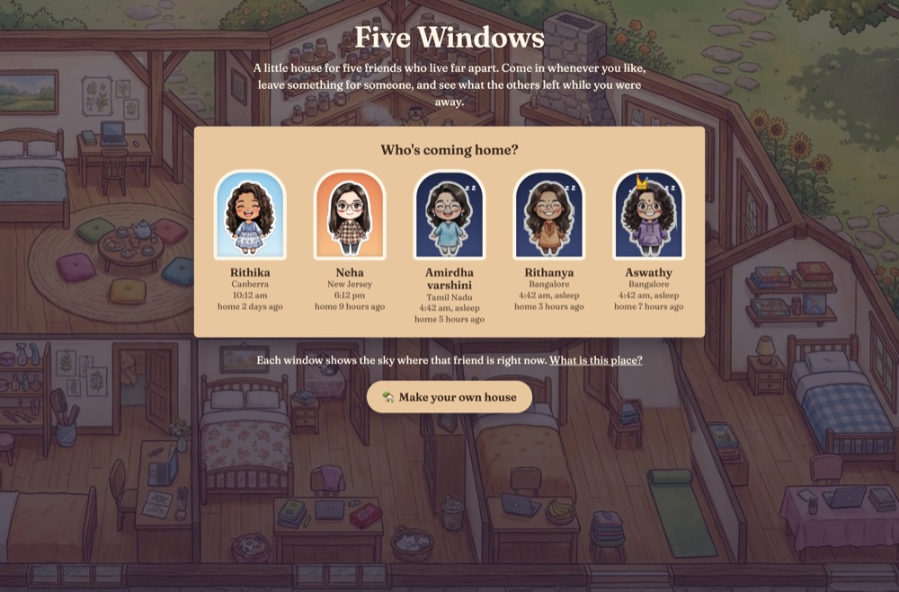

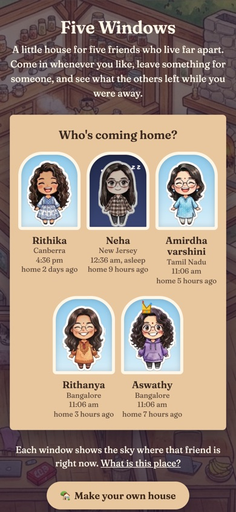 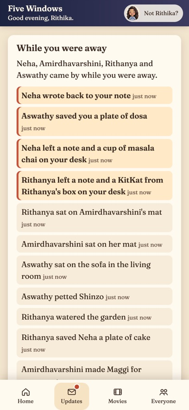

**Coming home** (above, right). I was last here two days ago, so Updates
starts with what was left for me (Neha writing back to my note, the dosa
Aswathy saved me, Neha's chai, Rithanya's KitKat), then who came by and what
they did.

**The house.** Everyone stands where they last stopped, and friends who are
home now glow. You walk yourself with the arrow keys, and whatever you walk
up to lights up, with its buttons above Go in (here, tidying my room).

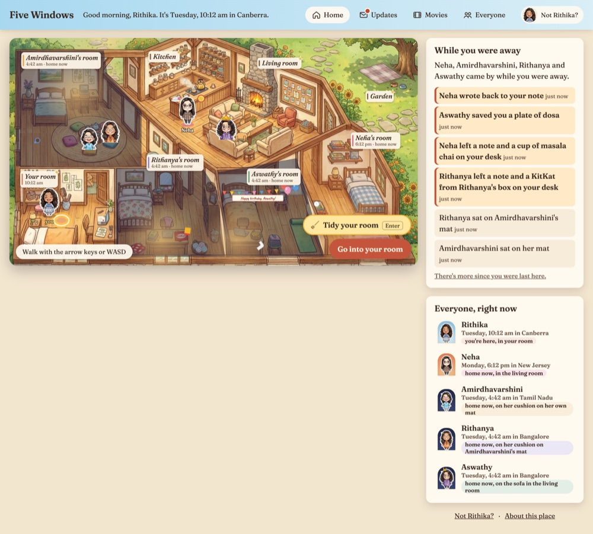

**On a phone** the house fills the screen. You walk by holding either bottom
corner and sliding your thumb: the stick comes up wherever your thumb lands,
so there's nothing to aim for, and the buttons stand above the corners, never
in them ([`1475dc3`](https://github.com/comp4020-agentic-coding-studio/comp4020-final-rithikanallaparaju16/commit/1475dc3)). Standing by Neha offers a hug; by the
sofa, a seat or a movie night.

**Writing back.** In my room, Neha has written back to the note I left on her
desk, and it says which note it's answering. Any note on my desk can be
written back to, once, and the answer goes on the writer's desk.

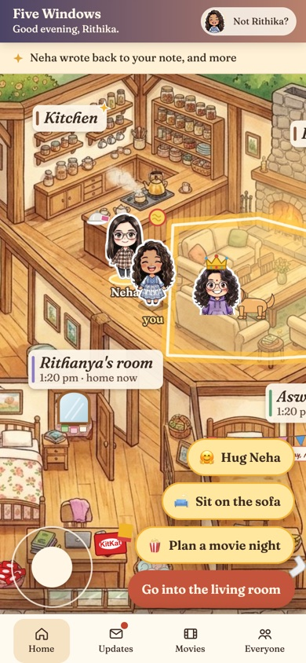

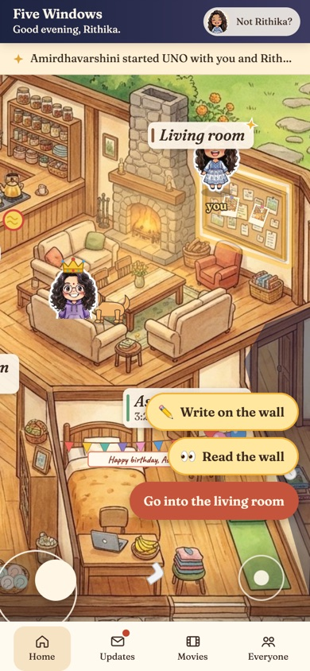

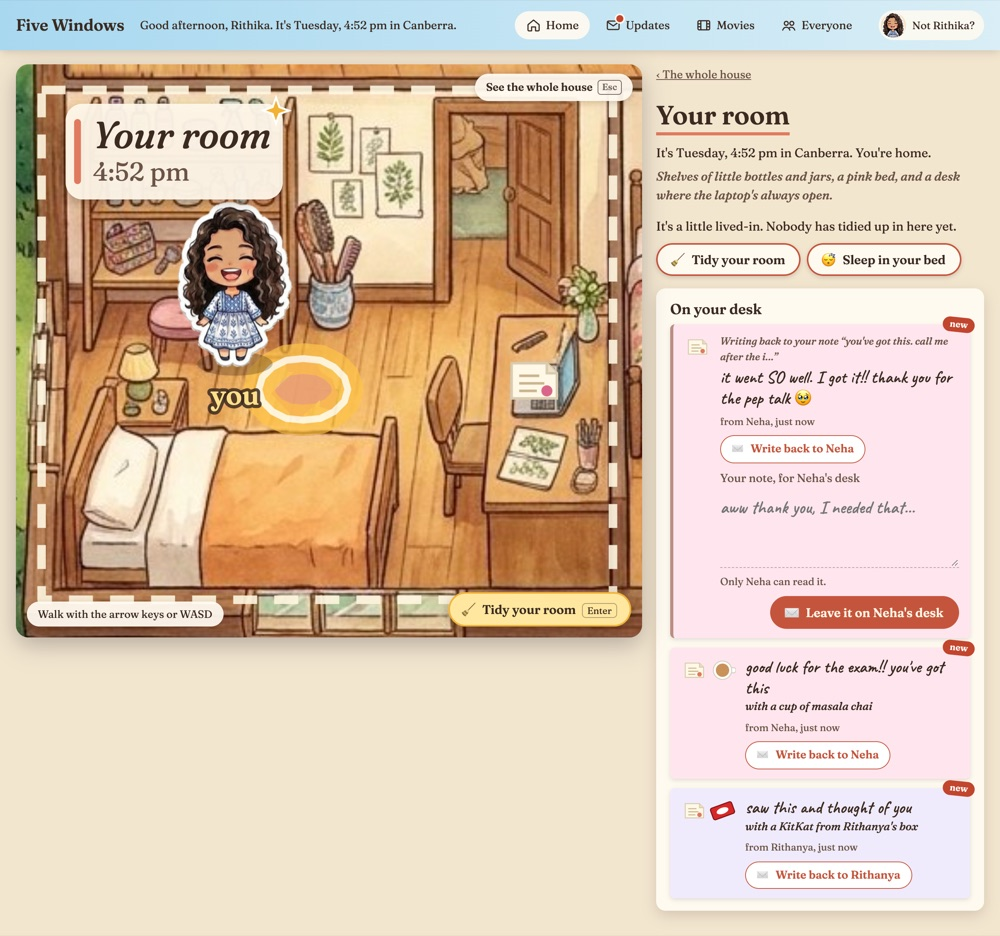

**No passwords, on purpose.** Notes on a desk are personal: other friends in
the house only see "A folded note for Rithika". But the door has no password,
so anyone with the link can come in as any friend whose window is free, and
then read that friend's desk. This is not a bug. I left passwords out for
now so my tutor can walk in as any of us and check and mark everything. A
front door key for each house is RICE row G, for after marking.

**The living room.** Big news is pinned at the top of the wall, with stickers
from friends (each one named, never counted). Shinzo follows whoever petted
him.

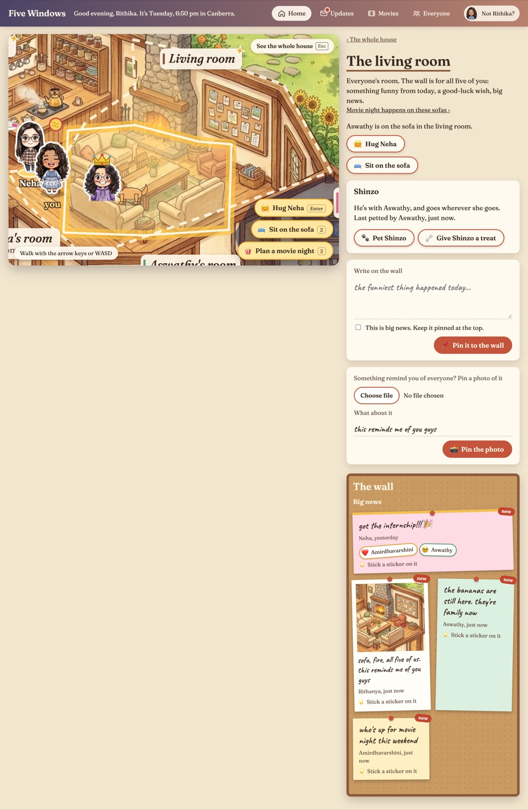

**A photo on the memory wall.** If something reminds you of everyone, take a
photo and pin it on the wall with a line about it ("this reminds me of you
guys" to start). It goes up as a polaroid, friends can put stickers on it
like any note, and only friends in the house can see it. The photo here is
a crop of the house's own picture, standing in for a real one
([`183b473`](https://github.com/comp4020-agentic-coding-studio/comp4020-final-rithikanallaparaju16/commit/183b473)).

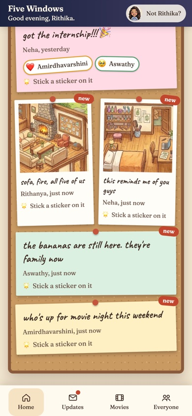

Photos also show small wherever the house mentions them: beside their line
in Updates, and as tiny polaroids on the living room's cork board in the
drawing of the house, pinned in the colour of whoever pinned them
([`6468e4a`](https://github.com/comp4020-agentic-coding-studio/comp4020-final-rithikanallaparaju16/commit/6468e4a)).

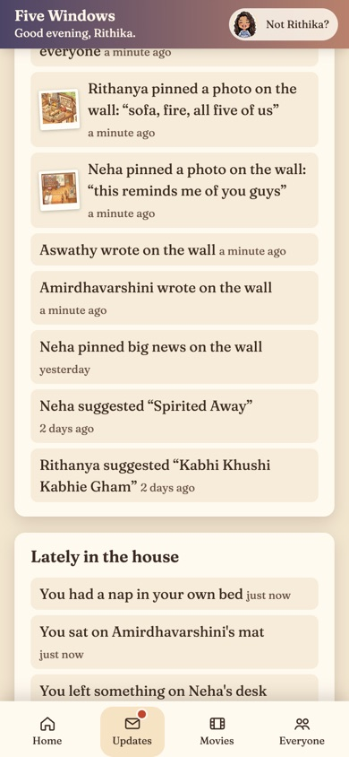

**The kitchen and garden.** Food out for everyone stays three days or until
someone eats it. A plate saved for a friend waits, covered, with her name on
it, however long she's away. Only she can eat it, and the cook hears she
found it. Anyone can water the garden, and the plants get thirsty but never
die.

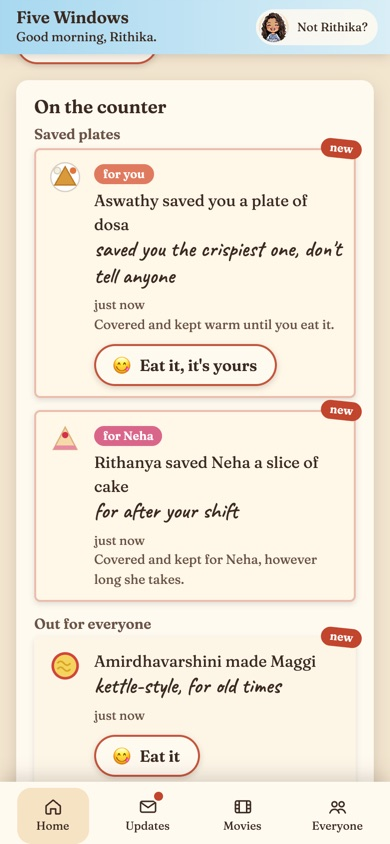 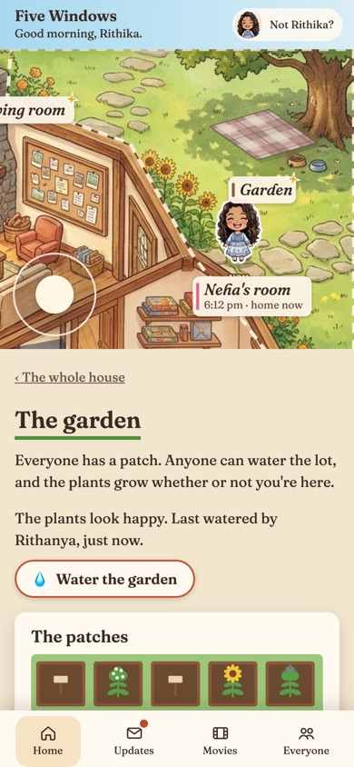

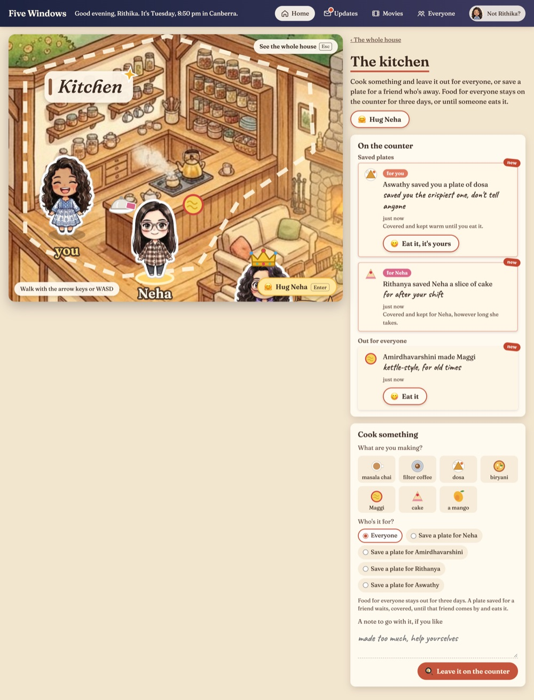

**Movies and UNO.** On Movies, the time for all of us comes first, then
suggesting a movie and the list ([`183b473`](https://github.com/comp4020-agentic-coding-studio/comp4020-final-rithikanallaparaju16/commit/183b473)). UNO is on
Amirdhavarshini's mat: seven cards each, twenty seconds a turn.

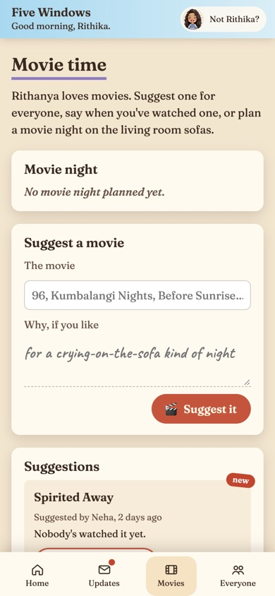 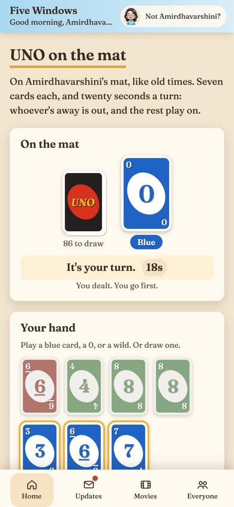

**The best time for all of us.** On the Everyone tab and on Movies, the
planner shows everyone's clock at once, for a video call or a movie night.
Some days I'm up early or Neha's up late, so you can start from anyone's
row. Here I set Neha's to 9:30 pm, every other row moved with it, and
Rithanya's says she's usually asleep then.

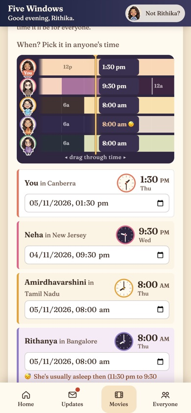 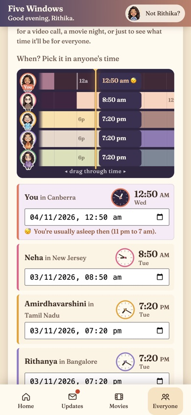

**Dragging through time** (above, right). Above the clocks is a strip with a
lane for each of us, showing her day, evening and sleep. Drag it with a
finger and time slides under the needle, and every clock's hands, its AM or
PM and its time follow as you drag, with no typing and no waiting. Each
lane starts with her face, not her initial, because two friends can share
one ([`fa8ce79`](https://github.com/comp4020-agentic-coding-studio/comp4020-final-rithikanallaparaju16/commit/fa8ce79), [`8b13b9a`](https://github.com/comp4020-agentic-coding-studio/comp4020-final-rithikanallaparaju16/commit/8b13b9a)).

**Everyone, and an iPad.** Where each of us is, on her own clock.

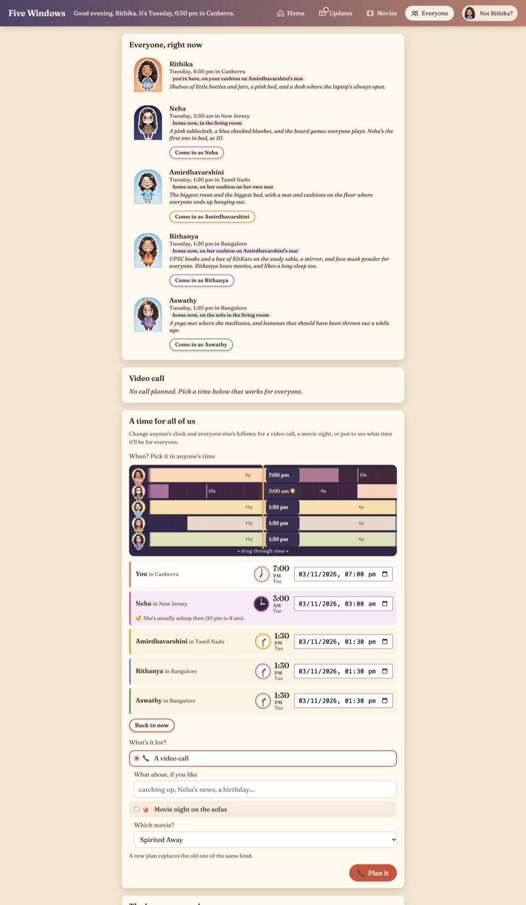

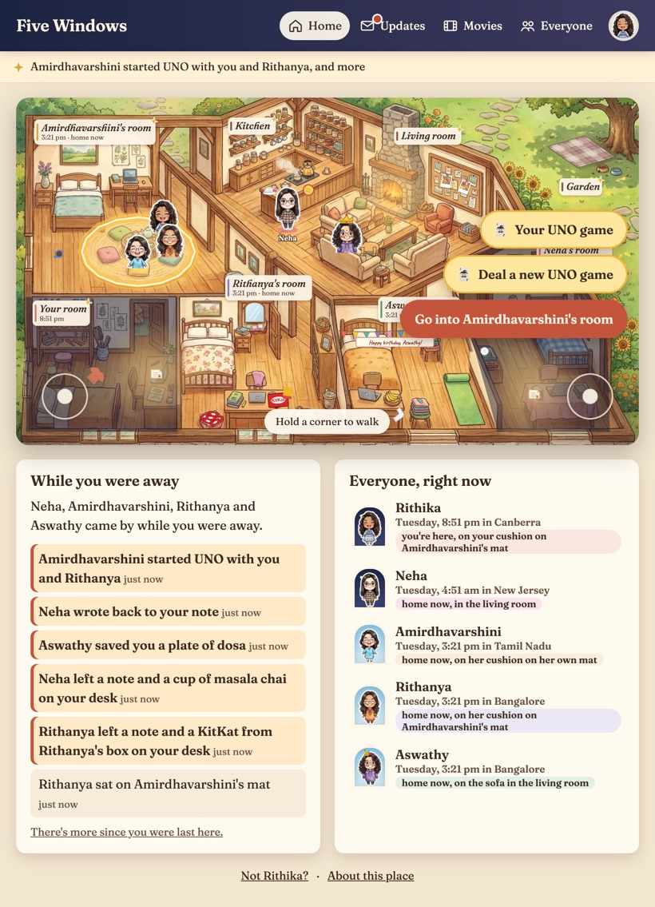

**Looking out from bed.** Lying in bed in my room, I press Esc (or tap See
the whole house) and the view zooms out to the whole house, so I can see
who's moving about without getting up. Esc again goes back into the room
([`5861540`](https://github.com/comp4020-agentic-coding-studio/comp4020-final-rithikanallaparaju16/commit/5861540)).

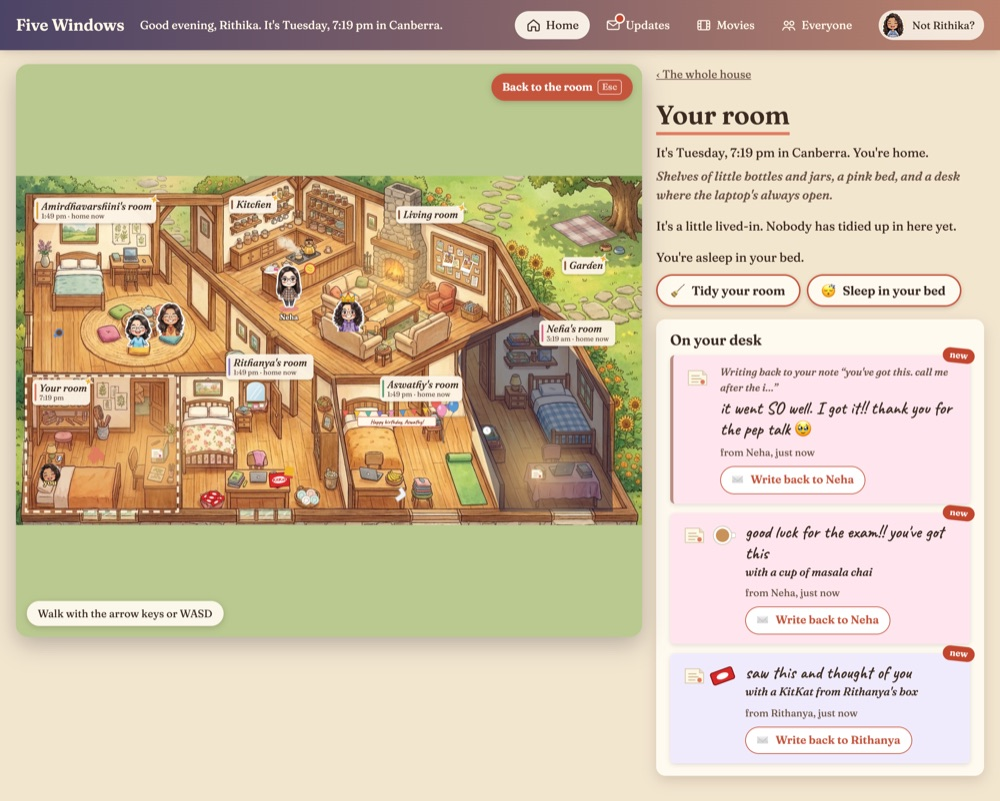

**A house for your own friends.** Anyone can make one at `/make` for two to
seven friends. While taking these I fixed the form's "You are" choices, which
had drifted away from their words ([`ce186f9`](https://github.com/comp4020-agentic-coding-studio/comp4020-final-rithikanallaparaju16/commit/ce186f9)).

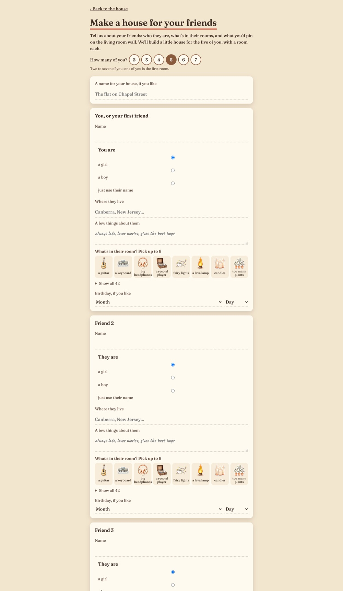

The name you give a house is on its door and at the top of every page. The
inside joke is framed at the door and on the memory wall in the living room,
and a little frame hangs on the living room wall in the picture ([`3aac38e`](https://github.com/comp4020-agentic-coding-studio/comp4020-final-rithikanallaparaju16/commit/3aac38e), [`cac59be`](https://github.com/comp4020-agentic-coding-studio/comp4020-final-rithikanallaparaju16/commit/cac59be)).

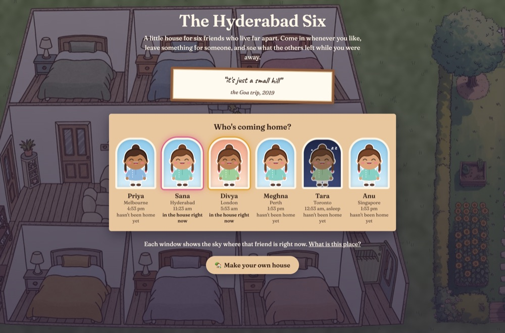

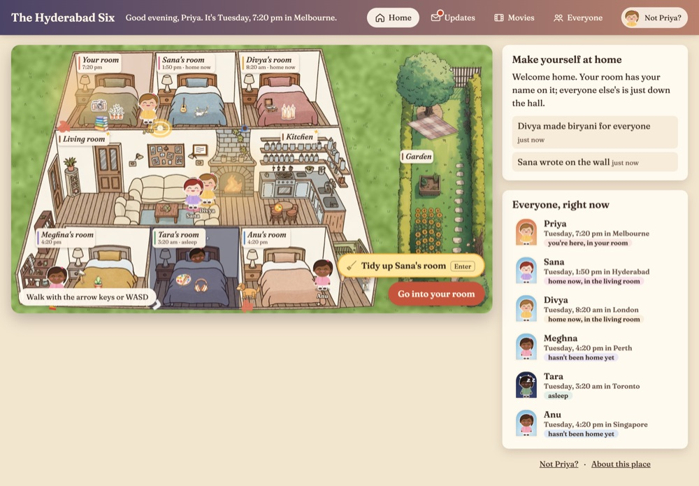

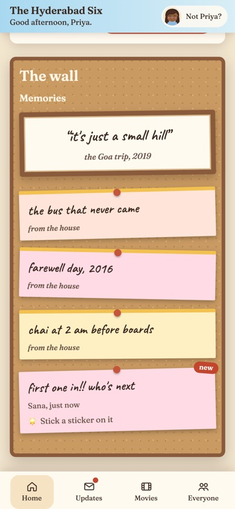

**On a phone's home screen.** The house can be added to the home screen on
Android and iPhone, with the living room fire as its icon, and it opens
without the browser around it. A made house goes on under its own name.

**A widget, like Locket.** Each of us can make a private link at the bottom
of the Everyone tab. A widget app reads it to show the newest photo or note
a friend left you, and everyone's face and clock. On an iPhone it uses the
free Scriptable app, and the house gives you the script with your link
already in it. On Android it uses KWGT. Making a new link turns the old one
off ([`ae63c78`](https://github.com/comp4020-agentic-coding-studio/comp4020-final-rithikanallaparaju16/commit/ae63c78)). I couldn't put it on a real phone from
here, so it was checked by running its script on a laptop.

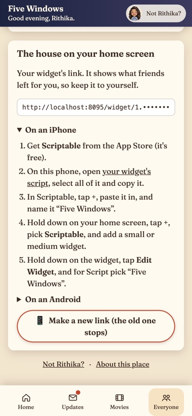

## Prompts

Every prompt I gave the agent from 8 October, word for word, with the commit it led to.

- "i want you to use liveview for viewing all the updates live, i should not need to refresh my page everytime to see what is going on. and if one person is logged in as one of us, nobody else can choose that person. so max of 5 users can only use my website. i want the avatars to be able to hug eachother. there can be a group hugs of 1,2,3,4 or evan and at max 5 people. the option should show if im close to any user that is online. i also wanna add birthdays and the avatars should be able to celebrate in the whole birthday month. the whole month there should be some decorations in the birthday girls room and a crown on her head. the dog, shinzo can wander whenever he wants. i want him to get up and wander, rn he wanders while sleeping on the mat.Fanning work out to subagents is encouraged for complex tasks. make sure they work together.make nehas sleeping hours to be 10. and give option of the avatars to play uno wheneber they sit togther in amirdhas room. make a uno game w 7 cards to each player. max of 5 players can play this game. so now i will add the birthdays rithika 16th october neha 2nd june aswathy 8th november rithanya january 12th Amirdha may 19th in process.md add this prompt and its hash. do this for every prompt so i can change it later": [`cd89e32`](https://github.com/comp4020-agentic-coding-studio/comp4020-final-rithikanallaparaju16/commit/cd89e32) (written up in [`2b110a0`](https://github.com/comp4020-agentic-coding-studio/comp4020-final-rithikanallaparaju16/commit/2b110a0))
- "continue and open the live after", "continue and ship it when done and open it live" and "continue": the same work, shipped as [`cd89e32`](https://github.com/comp4020-agentic-coding-studio/comp4020-final-rithikanallaparaju16/commit/cd89e32)
- "why is the living room dark": a question, no code change. It's night by my clock, and the shared rooms follow the visitor's clock.
- "the living room cant be dark, make it have light everything": [`e81ef0d`](https://github.com/comp4020-agentic-coding-studio/comp4020-final-rithikanallaparaju16/commit/e81ef0d)
- "the uno game is lagging, pls fix it": [`fdd9f94`](https://github.com/comp4020-agentic-coding-studio/comp4020-final-rithikanallaparaju16/commit/fdd9f94)
- "no common area should be dim, let it always have light, only rooms dim up in that particular persons timezone. and if somebody leaves the house, they quit from the game, dont make the others wait for their turn. and best way to check if someone is away is by a 10 sec timer. every player gets 10 sec for their turn": [`d0bcf63`](https://github.com/comp4020-agentic-coding-studio/comp4020-final-rithikanallaparaju16/commit/d0bcf63)
- "make it 20 seconds and push. i added reflections as well": [`0095db4`](https://github.com/comp4020-agentic-coding-studio/comp4020-final-rithikanallaparaju16/commit/0095db4), and my reflection in [`8c66048`](https://github.com/comp4020-agentic-coding-studio/comp4020-final-rithikanallaparaju16/commit/8c66048)

  so for the new update in the game-uno, i asked my friends to try it and 10 sec was too less so i chnaged it to 20sec ([`0095db4`](https://github.com/comp4020-agentic-coding-studio/comp4020-final-rithikanallaparaju16/commit/0095db4)).

- "so for the new update in the game-uno, i asked my friends to try it and 10 sec was too less so i chnaged it to 20sec. add this with the commit hash of prev prompt": [`e1c6183`](https://github.com/comp4020-agentic-coding-studio/comp4020-final-rithikanallaparaju16/commit/e1c6183)
- "push and ship it": shipped with my reflection's update in [`75b1794`](https://github.com/comp4020-agentic-coding-studio/comp4020-final-rithikanallaparaju16/commit/75b1794)
- "in the big memory wall, make it in a way that we can react to the news posted on it, like the person should know that we read it and how i feel so give everybody options of stickers to put on each news on memory board": [`eecb5f6`](https://github.com/comp4020-agentic-coding-studio/comp4020-final-rithikanallaparaju16/commit/eecb5f6)
- "can we ship it now": everything was already shipped and tagged `crit-9` at [`ce99177`](https://github.com/comp4020-agentic-coding-studio/comp4020-final-rithikanallaparaju16/commit/ce99177). I first chose to leave my draft of the rest of this file out of the snapshot, then changed my mind (below).

- "push it now after adding the commit hash for so for the new update in the game-uno, i asked my friends to try it and 10 sec was too less so i chnaged it to 20sec.": that note was already here with its commit, [`0095db4`](https://github.com/comp4020-agentic-coding-studio/comp4020-final-rithikanallaparaju16/commit/0095db4), so it went up with the log.
- "no push everything": my draft of this file went into the crit 9 snapshot, [`3627ef5`](https://github.com/comp4020-agentic-coding-studio/comp4020-final-rithikanallaparaju16/commit/3627ef5)
- "is this the final process.md? cuz i want the ending to have commit hash": brought this list up to date, so it ends on a commit, [`3627ef5`](https://github.com/comp4020-agentic-coding-studio/comp4020-final-rithikanallaparaju16/commit/3627ef5)
- "hi queen , lets start crit 10, first lets talk ab this idea. i wanna add an LLM where this website becomes for everybody …": we talked it through first and made the branch `llm-any-friends`.
- "but rooms should increase if its more friends, for now lets stick to 5 friends for the prototype, try your best to make this work, you can fan out subagents and make them talk and intereact w eachother queen, goodluck": the house can hold more than one house, [`0997905`](https://github.com/comp4020-agentic-coding-studio/comp4020-final-rithikanallaparaju16/commit/0997905); the maker agent built `/make`, [`083033e`](https://github.com/comp4020-agentic-coding-studio/comp4020-final-rithikanallaparaju16/commit/083033e); the rooms agent gave made houses their own rooms, [`71209b0`](https://github.com/comp4020-agentic-coding-studio/comp4020-final-rithikanallaparaju16/commit/71209b0)
- "continue and open the live site when youre donw", "live site, because i want to it be in process.md" and "continue and ship it when done, then open the live4 site": the who-did-what logs for crit 10, [`d669cbc`](https://github.com/comp4020-agentic-coding-studio/comp4020-final-rithikanallaparaju16/commit/d669cbc), and everything merged and shipped, [`09269ed`](https://github.com/comp4020-agentic-coding-studio/comp4020-final-rithikanallaparaju16/commit/09269ed)
- "continue and open the llm part for me to try" and "yes do whatever you should, its okay i trust you w my key": the house maker uses Claude on my own machine with my course key, never on the live site, [`1e762fe`](https://github.com/comp4020-agentic-coding-studio/comp4020-final-rithikanallaparaju16/commit/1e762fe)
- "open it for me": opened the house maker on my machine, no code change.
- "okayokay, ask gender and make the avatras accordingly": the form asks each friend's gender (girl, boy or just their name), [`17c0351`](https://github.com/comp4020-agentic-coding-studio/comp4020-final-rithikanallaparaju16/commit/17c0351); the art agent drew a chibi sticker for each, [`5b5e779`](https://github.com/comp4020-agentic-coding-studio/comp4020-final-rithikanallaparaju16/commit/5b5e779), and kept hair apart from skin, [`443b809`](https://github.com/comp4020-agentic-coding-studio/comp4020-final-rithikanallaparaju16/commit/443b809); the words agent made the house say she, he or they, [`003f110`](https://github.com/comp4020-agentic-coding-studio/comp4020-final-rithikanallaparaju16/commit/003f110); merged in [`0e39059`](https://github.com/comp4020-agentic-coding-studio/comp4020-final-rithikanallaparaju16/commit/0e39059)
- "continue and open it for me when done": shipped to the live site, [`3da0f14`](https://github.com/comp4020-agentic-coding-studio/comp4020-final-rithikanallaparaju16/commit/3da0f14)
- "just commit it": my crit 10 reflection, [`b17a158`](https://github.com/comp4020-agentic-coding-studio/comp4020-final-rithikanallaparaju16/commit/b17a158)
- "open the live site bro", "where is my llm", "try /make locally" and "can you swutch thiz to live?": opened the live site and the house maker on my machine, where Claude made a house; no code change.
- "deploy the site with llm", "i want the llm to work on the live site cant you do this without making my tokens public?", "But visitors do spend your credits. yes thats okay" and "done": my key is a Fly secret, so visitors making houses on the live site spend it, [`7642f54`](https://github.com/comp4020-agentic-coding-studio/comp4020-final-rithikanallaparaju16/commit/7642f54). Its first copy reached Fly empty, so the live maker isn't on Claude yet.
- "where should the token be for you" and "bro open live" (twice): the key is already in Claude Code's settings, so I got a command that reads it from there; opened the live site, no code change.
- "give me an option to make my own house, like make a button": a "Make your own house" button on the door, [`a590225`](https://github.com/comp4020-agentic-coding-studio/comp4020-final-rithikanallaparaju16/commit/a590225)
- "ship it thanks": the button on the live site, [`1f12c1f`](https://github.com/comp4020-agentic-coding-studio/comp4020-final-rithikanallaparaju16/commit/1f12c1f)
- "okay now all you do when i mention what should be there in the room is, just put a stiky note and write that on top, i want you to use the picture credits yuou have and actually draw what should be in the room, do this and ship the code": Claude draws each friend's first three things in her room, [`8cf868f`](https://github.com/comp4020-agentic-coding-studio/comp4020-final-rithikanallaparaju16/commit/8cf868f)
- "done": my key reached Fly, but the course proxy only answers the ANU network, so the live site can't use it; no code change.
- "do 3 and ship it": when Claude can't be reached, the house is made from the answers instead of an error, [`1934d52`](https://github.com/comp4020-agentic-coding-studio/comp4020-final-rithikanallaparaju16/commit/1934d52)
- "push everything": it was all pushed already, [`29480f7`](https://github.com/comp4020-agentic-coding-studio/comp4020-final-rithikanallaparaju16/commit/29480f7)
- "where is my LLM stored?": a question, no code change. Claude runs on Anthropic's servers; the app only holds the code that calls it, the key and what it made.
- "how can we create images then": a question, no code change. My course key can make images, but only from the ANU network.
- "when the user prompts in LLM, casn we use the course key to make those images?": a question, no code change. Only on my laptop with the VPN, not on the live site.
- "lets do this, make a set of images that people will generally use, and when the user is making 5 rooms for thier friends, give these opetions only": 42 pictures of room things, picked on the form, [`8f71174`](https://github.com/comp4020-agentic-coding-studio/comp4020-final-rithikanallaparaju16/commit/8f71174)
- "the images work good, but the persistence is weird whwn we use an LLM, pls check that, its not doing the "multiuser" part very well": made houses' live updates, steps and buttons were going to my house; now they stay in theirs, [`2696224`](https://github.com/comp4020-agentic-coding-studio/comp4020-final-rithikanallaparaju16/commit/2696224)
- "open live site, and ship all the chnages": shipped with my crit 11 reflection, [`b7810fc`](https://github.com/comp4020-agentic-coding-studio/comp4020-final-rithikanallaparaju16/commit/b7810fc)
- "now add test cases and test all parts of the website, fan out subagents and try the multiuser part as well, and report the issues": four agents tested the door, the maker, the house and several friends at once, and reported what they found; their tests wait on which bugs I want fixed, and one fix (zooming out of a made house's rooms) is in [`9289cc5`](https://github.com/comp4020-agentic-coding-studio/comp4020-final-rithikanallaparaju16/commit/9289cc5)
- "can you use more credits for images and make house layouts for diffeernt number of people.2,3,4,6,7 should be enpugh, try how much ever yu can, show me the images first, then we will proceed": a picture of a house for each size, shown to me first; no code change.
- "continue": a matching set of all five sizes, with the right number of bedrooms; no code change.
- "yes perfect rooms, continue": made houses for two to seven friends, each size on its own picture, with UNO at the coffee table, [`9289cc5`](https://github.com/comp4020-agentic-coding-studio/comp4020-final-rithikanallaparaju16/commit/9289cc5)
- "ship everything": the layouts on the live site, [`9289cc5`](https://github.com/comp4020-agentic-coding-studio/comp4020-final-rithikanallaparaju16/commit/9289cc5)
- "open the live site for this": opened the live site, no code change.
- "so now when making your own house, we have an option in the end where we tell sumn that we did in a group, then ask them for like an inside joke or quote ab it and keep that in the living room, just sumn for them to giggle when they enter their home": the maker asks for it at the end and frames it in the living room, [`3aac38e`](https://github.com/comp4020-agentic-coding-studio/comp4020-final-rithikanallaparaju16/commit/3aac38e)
- "skip those tests and ship it, then open live": the test sweep's 21 known-bug tests are skipped until fixed, and the spec files run one at a time so they stop locking each other out; the inside joke is on the live site, [`b0daaf5`](https://github.com/comp4020-agentic-coding-studio/comp4020-final-rithikanallaparaju16/commit/b0daaf5)
- "The three main frameworks / PRFAQ / Personas: five realistic people, each with a background, a reason to use the product and a quote. They test who the product is for and whether it works for each person. / RICE: (Reach × Impact × Confidence) ÷ Effort. It ranks what to build next. / Supporting tools" (pasted), then "do these for this app": a PRFAQ, five personas and a RICE ranking of what to build next, in `doc/`, [`63f3629`](https://github.com/comp4020-agentic-coding-studio/comp4020-final-rithikanallaparaju16/commit/63f3629)
- "what features do you suggest to add": a question, no code change.
- "house name,inside joke shoiuld be incorporated somewhere, then paste some screenshots of how the whole website workds in process.md": a made house's name is on its door, in the top bar and in every page's title, and its inside joke is framed at the door and on the living room wall; screenshots of the whole site are above, [`cac59be`](https://github.com/comp4020-agentic-coding-studio/comp4020-final-rithikanallaparaju16/commit/cac59be), [`ce186f9`](https://github.com/comp4020-agentic-coding-studio/comp4020-final-rithikanallaparaju16/commit/ce186f9)
- "add these screen shots in process.md under the heading overview of the website": the screenshot section is now headed "Overview of the website", [`591336a`](https://github.com/comp4020-agentic-coding-studio/comp4020-final-rithikanallaparaju16/commit/591336a)
- "push everything, and i cant see any screen shots in process.md": pushed and deployed. The screenshots were committed but not pushed, so GitHub didn't have them yet; they show under "Overview of the website" now, [`e2eaaca`](https://github.com/comp4020-agentic-coding-studio/comp4020-final-rithikanallaparaju16/commit/e2eaaca)
- "from personas,prfaqs and rice, what more featues do you suggest": a question, no code change.
- "okay, thankyou that gives a lot of insights / first i need you to update the screenshots you took in process.md / now after making the following chnages, take a few screenshots for that as well and show it / i agree w save the plate.lets do that / let notes in rooms be personal, for now lets not add passwords because my tutor has to check it, make sure you mention this in process.md, this is not a bug, just a way to keep it easier for the tutor to check and mark me. / then inside joke can be framed on the memory wall / i love the phone screen idea, lets do that as well, for both android and apple / i like the writnf back part aslo / i love the best time for all of us idea / lets cjnage it a bit becasue some days i can wake up very early or neha can sleep late / so when we are trying to pick a time, show all the times / i mean, as soon as there is an option to pick time, show all the time zones, changing one timezone reflects chnages in the others automatically. / do all this in a diff branch because if sumn goes wrong, it will be easier for us to get back where we were": on the branch `plates-replies-home-screen-times`, saving a plate, writing back, all five clocks for movie night, the joke on the memory wall and a home-screen icon, with the screenshots above retaken and the no-passwords note, [`74069c4`](https://github.com/comp4020-agentic-coding-studio/comp4020-final-rithikanallaparaju16/commit/74069c4)
- "nono let the planner be there from anytime, because sometimes we wanna video call as well, its easier to check times, so this planner can be used for video calling and all aslo, also make the app website show on homescreen like locket if you can do", then "also , make it such that, now if i go to my bed and fall asleep but when im laying if i wanna see who is moving in the house, only my room is zoomed in, when i click on esc key, no matter where i am, i have to zoom out and the whole house should be seen, after this open the live site. now make these changed apply to the house made also, not just the main house. so your tests should cover everything": the planner is on the Everyone tab and Movies from any time, and plans video calls too; Esc in any room zooms out to the whole house, in made houses as well; a Locket-style widget needs an App Store app, so it isn't built, [`5861540`](https://github.com/comp4020-agentic-coding-studio/comp4020-final-rithikanallaparaju16/commit/5861540)
- "keep screen shots and never delete them, because i can record them as a process.md, now for the planner, especialy the phone part, i wanna be able to scroll through the time an dsthen, live on the screen all the other time zones should also update, you can show a large clock, which shows AM and PM with the hands of it updating live, or a scroll, that scrolls all the timezones live. it has to be updatted very very quick, i shouldnt enter a time and wait. choose the best interactive way to do this": the planner has a strip of everyone's day and night to drag through with a finger or the mouse, and a clock each, whose hands, AM or PM and time follow on every frame; old screenshots are kept in `doc/screenshots/archive/` before any retake, [`fa8ce79`](https://github.com/comp4020-agentic-coding-studio/comp4020-final-rithikanallaparaju16/commit/fa8ce79)
- "open the live site": opened it, no code change.
- "open that branch, let me check it first": the `planner-strip` branch ran on this laptop and opened, no code change.
- "instead of name initials there, becasue they might be similar, give their avatars maybe?": the time strip shows each friend's face, ringed in her colour, instead of her initial, [`8b13b9a`](https://github.com/comp4020-agentic-coding-studio/comp4020-final-rithikanallaparaju16/commit/8b13b9a)
- "yes merge all the chnages now, and pls update process.md with the relavant screen shots": the screenshots above are retaken, with dragging through time (20) and looking out from bed (21) added, the older set kept in `doc/screenshots/archive/`, and the branch merged and shipped, [`8b13b9a`](https://github.com/comp4020-agentic-coding-studio/comp4020-final-rithikanallaparaju16/commit/8b13b9a)
- "can you make this into sumn i can view on the homescreen, like locket?", answered as iPhone and Android, showing the newest thing left for you with everyone's faces and clocks: a private widget link per friend, read by Scriptable on an iPhone or KWGT on Android, [`ae63c78`](https://github.com/comp4020-agentic-coding-studio/comp4020-final-rithikanallaparaju16/commit/ae63c78)
- "also, on memory wall, give the user an option to upload an image, so if sumn reminds them of the group, they can send an image saying, this reminds me of you guys": photos pinned on the memory wall as polaroids, [`183b473`](https://github.com/comp4020-agentic-coding-studio/comp4020-final-rithikanallaparaju16/commit/183b473)
- "in movies tab, i want the time thing to come first and then suggestions": the planner comes first on Movies, [`183b473`](https://github.com/comp4020-agentic-coding-studio/comp4020-final-rithikanallaparaju16/commit/183b473)
- "can we not show the pictures on the website itself? like small images": pinned photos show small beside their lines in Updates, as smaller polaroids on a phone's wall, and on the living room's cork board in the house, [`6468e4a`](https://github.com/comp4020-agentic-coding-studio/comp4020-final-rithikanallaparaju16/commit/6468e4a)
- "push everything and open it live": the photos, the widget and Movies' new order merged and shipped, and the live site opened, [`86c9c23`](https://github.com/comp4020-agentic-coding-studio/comp4020-final-rithikanallaparaju16/commit/86c9c23)
- "on the phone, its a little tricky to move charaters, we need to go to the toggle thingee to move my person in phone, make it like you dont need to go till there, if i touch botton left or bottom right corner it should be for moving only, and make it come in phone in a nice way": both bottom corners walk you, with the stick coming up under your thumb, and the buttons moved above them, [`1475dc3`](https://github.com/comp4020-agentic-coding-studio/comp4020-final-rithikanallaparaju16/commit/1475dc3)
- "how many images can you hold on the memory wall": answered, no code change: as many as the 1 GB volume holds, roughly 2,000 to 3,000 shrunk photos; the newest 24 notes and photos on the wall, the rest in the memory box.
- "okay manybe we can refresh the wall every month and give a recap whenever the user comes after the refresh, making sure nobody misses anything.
  also, is the homescreen thing working": the wall starts fresh each month by Canberra's clock, every month before kept in the memory box, and a recap of last month waits for each friend until she puts it away; the widget works on the server and in the spec but hasn't been tried on a real phone yet, [`11c3804`](https://github.com/comp4020-agentic-coding-studio/comp4020-final-rithikanallaparaju16/commit/11c3804)
- "just push it live, then i can test it on my phone": walking from the corners and the monthly wall shipped, [`65aaa81`](https://github.com/comp4020-agentic-coding-studio/comp4020-final-rithikanallaparaju16/commit/65aaa81)
- "the toggle is malfunctioning in phone, like in pubg if you see, when ever the user touches the bottom corners of the screen it is for movement, so it comes, here its not proper, try that well . on the phone when im in amirdhas room, i cant access the toggle because its far down, so even now if i touch the bottom corners of my screen it has to work like a toggle": on a phone the walking corners are the screen's own, in rooms too, and a quick tap still goes through, [`74c44de`](https://github.com/comp4020-agentic-coding-studio/comp4020-final-rithikanallaparaju16/commit/74c44de)
- "please do the widget thing, how can i even ask the app to do that, where is the option": Home shows the way to the widget, the Everyone tab gives the iPhone steps with a one-tap copy, and the iPhone script was fixed (it used something Scriptable doesn't have), [`74c44de`](https://github.com/comp4020-agentic-coding-studio/comp4020-final-rithikanallaparaju16/commit/74c44de)
- "queen, what happened to the widget thing i told you": answered, no code change: it was built and committed, but its push to the live site was blocked waiting for a go-ahead.
- "in my phone, the toggle is still not fixed
  i cant see the kicthen when im trying to move an avatar": the toggle fix wasn't live yet; on a phone the view now leads the way you walk, so the kitchen comes into sight ahead of you, [`81d76a0`](https://github.com/comp4020-agentic-coding-studio/comp4020-final-rithikanallaparaju16/commit/81d76a0)
- "pls push all this to live now queen": the screen's corners for walking, the widget and the leading view shipped, [`f9494f3`](https://github.com/comp4020-agentic-coding-studio/comp4020-final-rithikanallaparaju16/commit/f9494f3)
- (a paste of the live Home page's HTML source, signed in as Amirdhavarshini, with no words of her own; too long to copy here word for word): read as the toggle still not working on her phone; the page's own scripts were being kept stale by the phone, and now carry a fingerprint so that can't happen, [`8323d30`](https://github.com/comp4020-agentic-coding-studio/comp4020-final-rithikanallaparaju16/commit/8323d30)
- "this is what downloaded on my phone as soon i clicked on the link, why did that happen? fix it
  i want the widget thing to work. when i enter the home through laptop,phone or ipad, there should be an option asking if i want the widget on my homescreen, if i say yes, it has to work
  the widget can show memory board, their room, show food or the note preview if somebody left food for them, it could also be the memory board, pictures of all the avatars
  anything wholesome, it can keep chnaging. it can show the birthday persons avatar on their birday, prev day aslo. sumn like this.": Home asks each device Yes / Not now, Yes shows the steps for that device and says when the widget's working, and the widget shows a different card each time (birthdays, a note or plate left for you, the memory wall, your room, everyone, Shinzo); held tabs no longer offer Safari's download, [`8323d30`](https://github.com/comp4020-agentic-coding-studio/comp4020-final-rithikanallaparaju16/commit/8323d30)
- "widget can rotatae every time the user uses their phone, i dont want a lot of battery to be consumed. after this push the live chnages so i can test on my iphone and mac, later i will test on android as well": a new card each time the phone redraws it, one small question to the house at most every few minutes, every picture kept on the phone; and the widget updates itself, [`8323d30`](https://github.com/comp4020-agentic-coding-studio/comp4020-final-rithikanallaparaju16/commit/8323d30)
- "now do the same rice,prfaqs,personas and suggest more ideas for this app": the PRFAQ, personas and RICE rewritten for the house as it is on 4 November (the widget, photos, the monthly wall, saved plates, writing back, the time strip), with new ideas scored, [`eee8d97`](https://github.com/comp4020-agentic-coding-studio/comp4020-final-rithikanallaparaju16/commit/eee8d97)
- "also pls check the login, when i login as rithika, i want my widget also to show updates for me, pls check that. make sure all these chnaged are done to "make your own house" as well. even new users using this app, need to get the same experience": each friend's widget is her own and now says whose it is; the widget on Rithika's phone was set up as Amirdhavarshini. Made houses get the whole widget, faces and rooms included, [`68a3b38`](https://github.com/comp4020-agentic-coding-studio/comp4020-final-rithikanallaparaju16/commit/68a3b38)
- "push it and give me the feature updates you did from rice,prfaqs and personas": pushed and checked live; listed what the three documents led to, [`f2aeea1`](https://github.com/comp4020-agentic-coding-studio/comp4020-final-rithikanallaparaju16/commit/f2aeea1)
- "when amirdha puts a note on my desk, i want a small preview. if theres an update on the mermory wall i want a small preview on my widget
  if amirdha leaves a note on nehas desk, i dont need a preview, but if food is left on the counter for me i need to see, but if its a note, it could be private, so dont read it
  but memory wall wont be private. so maybe ask if it can be shown on the widget before you show. because if its like a nice motivational thing id love to see it": what's new for you shows first on the widget; a friend's desk note never shows; the wall reaches widgets only when its writer ticks the box, [`b863836`](https://github.com/comp4020-agentic-coding-studio/comp4020-final-rithikanallaparaju16/commit/b863836)
- (a paste of the reply's "From this round" and "Highest-scoring ideas not built yet" lists) "do all of these and push the live site": sealed birthday cards, Home's line naming who came by, and made houses keeping the right clocks, shipped with the widget previews, [`51511dd`](https://github.com/comp4020-agentic-coding-studio/comp4020-final-rithikanallaparaju16/commit/51511dd)
- "make all these work for "make your own houses" as well": each of them works in made houses, with a spec there, [`51511dd`](https://github.com/comp4020-agentic-coding-studio/comp4020-final-rithikanallaparaju16/commit/51511dd)
- "more features": asked which, with two lists of four, [`2afa797`](https://github.com/comp4020-agentic-coding-studio/comp4020-final-rithikanallaparaju16/commit/2afa797)
- "nono ask again, i loved the ideas": asked again; picked leave the light on, on this day, the next call on the widget, a line under a photo, a made house's own dog and page, and tell them I was here, all built for both kinds of house, [`2afa797`](https://github.com/comp4020-agentic-coding-studio/comp4020-final-rithikanallaparaju16/commit/2afa797)
- "push it live": checked, then pushed, [`2afa797`](https://github.com/comp4020-agentic-coding-studio/comp4020-final-rithikanallaparaju16/commit/2afa797)
- "try now, continue": carried on after a check without a verdict held up writing the ADR, [`2afa797`](https://github.com/comp4020-agentic-coding-studio/comp4020-final-rithikanallaparaju16/commit/2afa797)
- (a photo of her phone held sideways) "this is my phone screen, right now we cant even see the toggle, i want you to force only landscpae for phone because you can see the house only then, and make the toggle visibile no matter where i am.The toggle should be there on the bottom corners of my screen not the page. fix this and push it live": sideways, the house fills the screen with its walking corners on the screen's corners; upright, it asks to be turned, [`397f8b1`](https://github.com/comp4020-agentic-coding-studio/comp4020-final-rithikanallaparaju16/commit/397f8b1)
- "also, amirdha tried from her laptop and her phone, she uses windows and android she says she didnt get the pop up thingee i got for downloading the widget. fix the issue": every browser is asked until it answers; Windows is told the widget lives on a phone, [`397f8b1`](https://github.com/comp4020-agentic-coding-studio/comp4020-final-rithikanallaparaju16/commit/397f8b1)
- "i also want like a diary or memory box thing, for each avatar.
  for example i like the birthday card neha wrote for me, i should be able to save it and revisit later. if i like sumn from memory wall, i should be abke to save a copy of it. if the memory is exceeding, give the user an option to save it to their devices and delete a few. make these chnages for the made houses also": not built; called off below, [`d6976a7`](https://github.com/comp4020-agentic-coding-studio/comp4020-final-rithikanallaparaju16/commit/d6976a7)
- "also, make it into a testflight app for now, for android also sumn like that": asked about the accounts it needs; called off below, [`d6976a7`](https://github.com/comp4020-agentic-coding-studio/comp4020-final-rithikanallaparaju16/commit/d6976a7)
- "then push everything to live, i want it to work amazing on testflight": everything pushed and checked live, [`d6976a7`](https://github.com/comp4020-agentic-coding-studio/comp4020-final-rithikanallaparaju16/commit/d6976a7)
- "nvm, lets j do website for now" (answering the app question): no TestFlight or Android app, [`d6976a7`](https://github.com/comp4020-agentic-coding-studio/comp4020-final-rithikanallaparaju16/commit/d6976a7)
- "noo lets skip that, omnly a good, well designed website": no keepsake box either; the website only, [`d6976a7`](https://github.com/comp4020-agentic-coding-studio/comp4020-final-rithikanallaparaju16/commit/d6976a7)
- "buid a webapp of this that renders like a mobile app in phone,so even distribution becaomes easy
  same applies for make your owb house as well": each house hands itself out as an app (Install, Share, a QR code, steps per device), works offline kindly, and made houses too, [`2e3c9d2`](https://github.com/comp4020-agentic-coding-studio/comp4020-final-rithikanallaparaju16/commit/2e3c9d2)
- (a screenshot of her iPhone's widget) "as rithika why am i getting that widget?": it's Amirdhavarshini's widget, showing the note Rithika left her; a question, no code change
- "nono, dont have to add a line, but suggest me ways to login as only rithika, idk why im making the mistake of loggin in as some other person everytime": four ways suggested, no code; it led to the greeting below, [`272a413`](https://github.com/comp4020-agentic-coding-studio/comp4020-final-rithikanallaparaju16/commit/272a413)
- "i like C": coming in as anyone, Home says "Hi Rithika 👋" with her face for a few seconds, and "Not you? Change" goes back to the door; made houses too, [`272a413`](https://github.com/comp4020-agentic-coding-studio/comp4020-final-rithikanallaparaju16/commit/272a413)
- "push it live": pushed and checked live, [`272a413`](https://github.com/comp4020-agentic-coding-studio/comp4020-final-rithikanallaparaju16/commit/272a413)
- "now i want you to look at the entire project, and the final assignment spec / tell me wehat i should do more to get an amazing grade": read the brief, the rubric and the repo, and looked at the house at both marking viewports; an upright phone sees only "Turn your phone sideways" inside the house. Advice, and [`0ce7d7b`](https://github.com/comp4020-agentic-coding-studio/comp4020-final-rithikanallaparaju16/commit/0ce7d7b)
- "also for the project, do rice,prfaqs and personas and come up with more chnaged from the prev prompt / after both of this give me a final message telling me mopre improvements for proj marks wise and projects wise": RICE rescored with rows AI to AO, the personas and PRFAQ walked through again, [`0ce7d7b`](https://github.com/comp4020-agentic-coding-studio/comp4020-final-rithikanallaparaju16/commit/0ce7d7b)
- "yes do all that": an upright phone gets the house (ADR 0035), live pages catch up after a dropped line, an accessibility floor over every page, four sweep bugs fixed, and where each correction landed, [`df68a9c`](https://github.com/comp4020-agentic-coding-studio/comp4020-final-rithikanallaparaju16/commit/df68a9c), [`1a27d10`](https://github.com/comp4020-agentic-coding-studio/comp4020-final-rithikanallaparaju16/commit/1a27d10)
