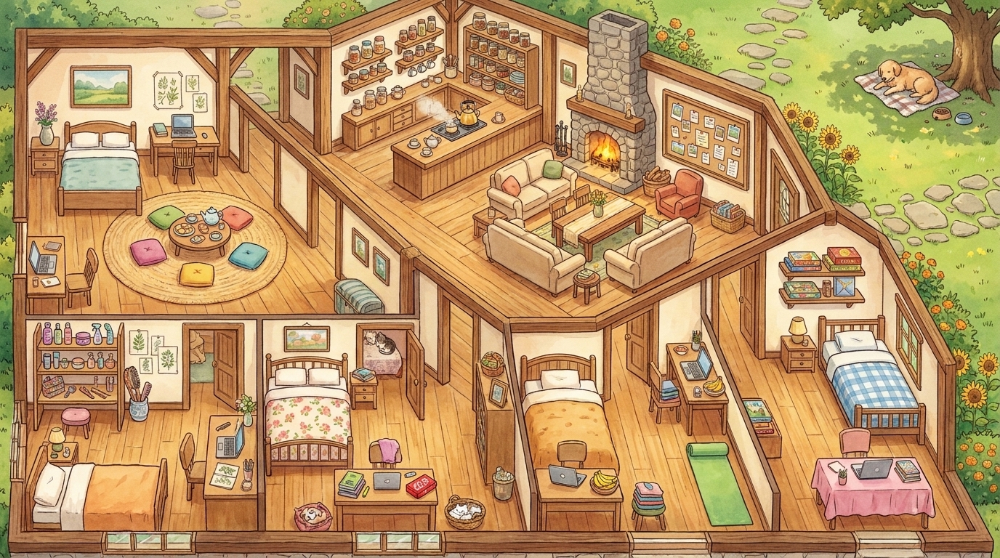
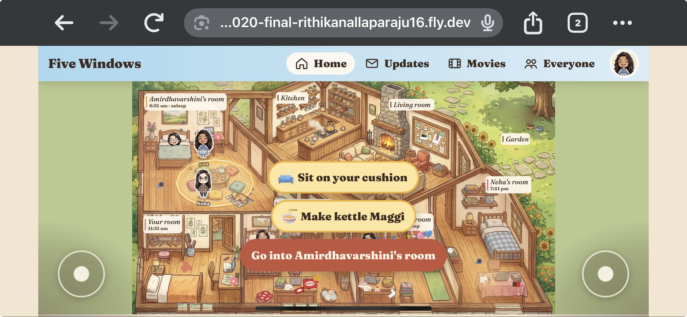
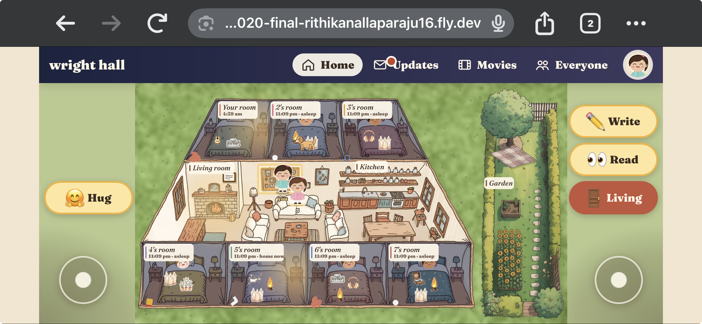
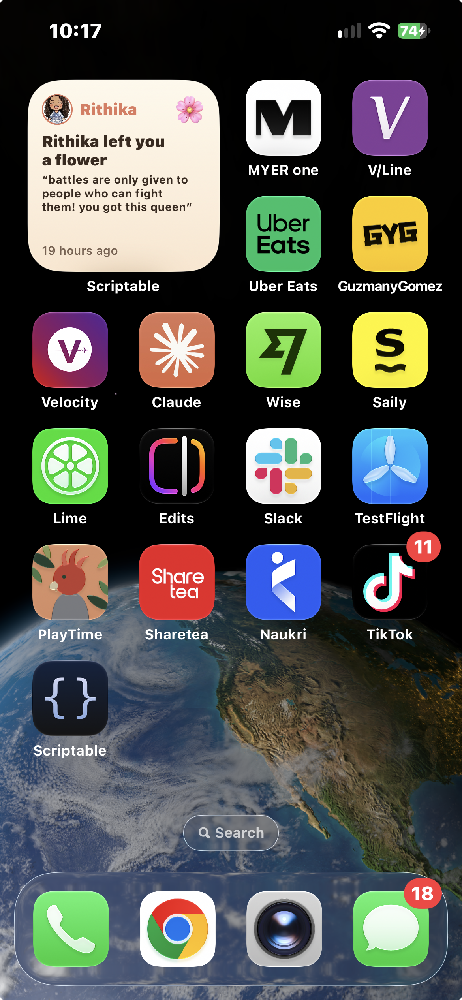
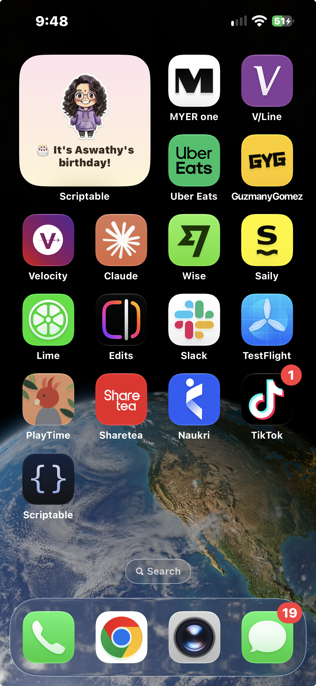
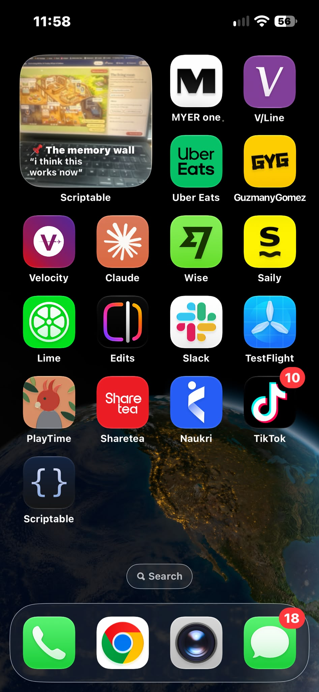
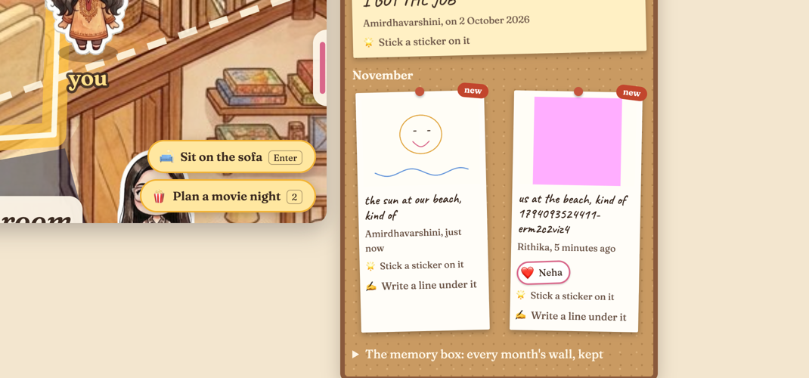

# Process

## The problem, and the principle

Four close friends and I live in Canberra, New Jersey, Tamil Nadu and
Bangalore, and we're almost never online at the same time. I didn't want
another chat app. The one principle I gave the agent was that *connection
must not require being online at the same time*: someone comes by for thirty
seconds, leaves something and goes, and someone else finds it days later.
[README.md](README.md) argues what "good" means for this house. This file is
how I got from that to the harness, the stack and the app.

The main idea of this house is to feel loved no matter where you are. You dont need to wait for anybody to come online and talk to you. You can go back to the house, read the notes your besties left for you, write them back, leave voice notes, update your friends w something that reminded you of them, see all of your memory wall etc. Best part is, this app never disturbs you, it quietly sits as a widget on your wallpaper, just click and go to your virtual house whenevr you feel like it. The small widget is the size you choose and keeps showing small updates to make you feel loved even though y'all are miles away.

Made this same idea, work for other friends as well as suggested by my tutor. So now, any body can make a group of maximum of 7 friends, give their timezones,name,gender,birthday and what they need in their room to generate an entire house for you. The made house works similar to the main one but the things that you wanted in their room will not be placed well.

## From a brief to a harness

I started with a long direction prompt. It covered the product, the feeling
(warm, a bit nostalgic, never a feed or a dashboard), a seven-point
definition of good, and how I wanted to work. The agent turned it into
`CLAUDE.md` and built a first slice, notes left on a kitchen table, in
[`0ed431d`](https://github.com/comp4020-agentic-coding-studio/comp4020-final-rithikanallaparaju16/commit/0ed431d).

The agent makes the small calls and names every product decision in its
reply, so I can redirect it. This app is very personal. To give the reader a gist
Rithanya: She always had face masks in her room where we all used to go and spend time using them, she loves kitkats. You can see these in her room
Neha:She is a big fan of board games and has a large time difference with me. I also tried to recreate her checked blue blanket.
Amirdha: We loved hanging out in her room and in our hostel we werent allowed to cook so we used to sneak in a kettle to make instant noodles(maggie), so i made her room the biggest and made a place where all of us can sit and make maggie. We can also play UNO there like we used to in our hostel.
Aswathy: She is the person who got me into meditation. This helped me in a lot of ways, i used to go to her room every morning to meditate on the yoga mat which you can see there
Added birthdays as well, on that whole month the room will be decorated.
There is a shared memory board, a place on each of our desk where you can leave personal notes etc
These are just a small part of a large amount of detail. 
 Every prompt, correction and commit is in [doc/process-log.md](doc/process-log.md). Big
decisions are [ADRs](doc/adr/), and changing one means writing a new record
that supersedes it. When I asked for a walkable avatar, which
[ADR 0007](doc/adr/0007-the-stitch-illustration-with-an-svg-layer-and-a-little-javascript.md)
had turned down, the agent wrote
[ADR 0008](doc/adr/0008-you-walk-yourself-and-nobody-else-moves.md) rather
than editing 0007.

## step by step

The stack is Node 24 running TypeScript directly, `node:sqlite` on the Fly
volume, server-rendered HTML forms, and no runtime dependencies
([ADR 0001](doc/adr/0001-a-zero-dependency-node-server-with-html-forms.md),
[ADR 0002](doc/adr/0002-store-the-house-in-sqlite-on-the-fly-volume.md)).
That's sized to five people, one small machine, and one volume that
survives a redeploy. A JSON file would have held our notes, but SQLite gives
crash-safe writes for free. A markdown library would have rendered
`/readme/`, but a small renderer kept dependencies at zero, at the cost of a
rule that the README stays inside what it supports.

Everything anyone leaves is a row in one append-only table, and the state of
the house (a lived-in room, a thirsty plant, where the dog is) is worked out
from timestamps, not timers
([ADR 0005](doc/adr/0005-one-log-of-things-with-state-derived-from-time.md)).
That's how the house never punishes absence: nothing counts down while
you're away. Where you stopped walking is current state rather than
something you left, so it lives on your `visits` row instead
([ADR 0009](doc/adr/0009-the-house-keeps-where-you-stopped.md),
[`8c0b81e`](https://github.com/comp4020-agentic-coding-studio/comp4020-final-rithikanallaparaju16/commit/8c0b81e)).

The rooms and people are personlized and apply to my close friends. for now player can take the character of one of us and continue.

I will add passwords on login once the marker checks my crit, i didnt want extra load for the marker when they try to login on 2 devices as 2 people.

Used google stich to come up with the avatars and areas. it was easier to re iterate and get the layout of the house and how my avatars should look using stitch

need to make the app persistent. right now it works on every refreshing.

The following shows the corrections i had to make. This website is very personalised and was very difficult to tell claude. The funniest one would be when
asked claude to personalise my friends room by placing a kitkat box, instead claude added cats, A BOX OF CATS.
  [`df979fe`](https://github.com/comp4020-agentic-coding-studio/comp4020-final-rithikanallaparaju16/commit/df979fe),
  

## Overview of the website
**The door.** Pick your window. Once you enter you can see the time at each of your friends place. We had another difficulty of matching time for video call. So i added a functionality where if i wanna choose a time, the same window will show time as i chnage mine so that we can easily set a time where all of us are free

 

**Coming home** This will show you what happened while you were away. The main part of this website is that we do not have any notifications to disturb anybody. So this quietly shows you what your besties did. It could be leave a voice note, upadte memory wall, play w Shinzo, gave you a hug, left the light on for you etc.

**The house.** You could tidy up your friends room, cook something and leave it on the table for them, etc

**On a phone** Tried to fix layouts in different devices, This task was tougher than i thought because there were a lot of options and a few things might need to render differenetly based on the size of the device. For example on a phone the buttons just have emojis for user to understand the option. large buttons were ruining the experience.

This is a made house of 7 people where you can see the change

([`1475dc3`](https://github.com/comp4020-agentic-coding-studio/comp4020-final-rithikanallaparaju16/commit/1475dc3)). 

**Writing back.** In my room, Neha has written back to the note I left on her
desk, and it says which note it's answering. Any note on my desk can be
written back to, once, and the answer goes on the writer's desk.

**The living room.** Big news is pinned at the top of the wall, with stickers
from friends (each one named, never counted). Shinzo follows whoever petted
him.

**A photo on the memory wall.** If something reminds you of everyone, take a
photo and pin it on the wall with a line about it ("this reminds me of you
guys" to start). It goes up as a polaroid, friends can put stickers on it
like any note, and only friends in the house can see it. The photo here is
a crop of the house's own picture, standing in for a real one
([`183b473`](https://github.com/comp4020-agentic-coding-studio/comp4020-final-rithikanallaparaju16/commit/183b473)).

Photos also show small wherever the house mentions them: beside their line
in Updates, and as tiny polaroids on the living room's cork board in the
drawing of the house, pinned in the colour of whoever pinned them
([`6468e4a`](https://github.com/comp4020-agentic-coding-studio/comp4020-final-rithikanallaparaju16/commit/6468e4a)).

**The kitchen and garden.** Food out for everyone stays three days or until
someone eats it. A plate saved for a friend waits, covered, with her name on
it, however long she's away. Only she can eat it, and the cook hears she
found it. Anyone can water the garden, and the plants get thirsty but never
die.

 

**Movies and UNO.** On Movies, the time for all of us comes first, then
suggesting a movie and the list ([`183b473`](https://github.com/comp4020-agentic-coding-studio/comp4020-final-rithikanallaparaju16/commit/183b473)). UNO is on
Amirdhavarshini's mat: seven cards each, twenty seconds a turn.

 

**The best time for all of us.** On the Everyone tab and on Movies, the
planner shows everyone's clock at once, for a video call or a movie night.
Some days I'm up early or Neha's up late, so you can start from anyone's
row. Here I set Neha's to 9:30 pm, every other row moved with it, and
Rithanya's says she's usually asleep then.

 

**Dragging through time** (above, right). Above the clocks is a strip with a
lane for each of us, showing her day, evening and sleep. Drag it with a
finger and time slides under the needle, and every clock's hands, its AM or
PM and its time follow as you drag, with no typing and no waiting. Each
lane starts with her face, not her initial, because two friends can share
one ([`fa8ce79`](https://github.com/comp4020-agentic-coding-studio/comp4020-final-rithikanallaparaju16/commit/fa8ce79), [`8b13b9a`](https://github.com/comp4020-agentic-coding-studio/comp4020-final-rithikanallaparaju16/commit/8b13b9a)).

**Everyone, and an iPad.** Where each of us is, on her own clock.

**Looking out from bed.** Lying in bed in my room, I press Esc (or tap See
the whole house) and the view zooms out to the whole house, so I can see
who's moving about without getting up. Esc again goes back into the room
([`5861540`](https://github.com/comp4020-agentic-coding-studio/comp4020-final-rithikanallaparaju16/commit/5861540)).

**A house for your own friends.** Anyone can make one at `/make` for two to
seven friends. While taking these I fixed the form's "You are" choices, which
had drifted away from their words ([`ce186f9`](https://github.com/comp4020-agentic-coding-studio/comp4020-final-rithikanallaparaju16/commit/ce186f9)).

The name you give a house is on its door and at the top of every page. The
inside joke is framed at the door and on the memory wall in the living room,
and a little frame hangs on the living room wall in the picture ([`3aac38e`](https://github.com/comp4020-agentic-coding-studio/comp4020-final-rithikanallaparaju16/commit/3aac38e), [`cac59be`](https://github.com/comp4020-agentic-coding-studio/comp4020-final-rithikanallaparaju16/commit/cac59be)).

**On a phone's home screen.** The house can be added to the home screen on
Android and iPhone, with the living room fire as its icon, and it opens
without the browser around it. A made house goes on under its own name.

**A widget, like Locket.** Each of us can make a private link at the bottom
of the Everyone tab. A widget app reads it to show the newest photo or note
a friend left you, and everyone's face and clock. On an iPhone it uses the
free Scriptable app, and the house gives you the script with your link
already in it. On Android it uses KWGT. Making a new link turns the old one
off ([`ae63c78`](https://github.com/comp4020-agentic-coding-studio/comp4020-final-rithikanallaparaju16/commit/ae63c78)). I couldn't put it on a real phone from
here, so it was checked by running its script on a laptop.

## Prompts

Every prompt I gave the agent from 8 October, word for word, with the commit it led to.

This prompt was mainly for persistence and live refresh [`cd89e32`](https://github.com/comp4020-agentic-coding-studio/comp4020-final-rithikanallaparaju16/commit/cd89e32) (written up in [`2b110a0`](https://github.com/comp4020-agentic-coding-studio/comp4020-final-rithikanallaparaju16/commit/2b110a0))

Fixed the UNO game 
[`e1c6183`](https://github.com/comp4020-agentic-coding-studio/comp4020-final-rithikanallaparaju16/commit/e1c6183)
- "push and ship it": shipped with my reflection's update in [`75b1794`](https://github.com/comp4020-agentic-coding-studio/comp4020-final-rithikanallaparaju16/commit/75b1794)

- Started to work on "make your own house" but this was creating problems because on the fly if we try to make the house after the prompt, then we use an API key, so that wasnt working very well. So I made a few designs of prefined housed and then went ahead with this plan`llm-any-friends`.
[`0997905`](https://github.com/comp4020-agentic-coding-studio/comp4020-final-rithikanallaparaju16/commit/0997905); the maker agent built `/make`, [`083033e`](https://github.com/comp4020-agentic-coding-studio/comp4020-final-rithikanallaparaju16/commit/083033e); the rooms agent gave made houses their own rooms, [`71209b0`](https://github.com/comp4020-agentic-coding-studio/comp4020-final-rithikanallaparaju16/commit/71209b0)

Here is where i worked on what information to ask the user to make their own house, Each friend will have a set of options to choose what is to be there in their room. these things are predefined
 [`17c0351`](https://github.com/comp4020-agentic-coding-studio/comp4020-final-rithikanallaparaju16/commit/17c0351); the art agent drew a chibi sticker for each, [`5b5e779`](https://github.com/comp4020-agentic-coding-studio/comp4020-final-rithikanallaparaju16/commit/5b5e779),  [`a590225`](https://github.com/comp4020-agentic-coding-studio/comp4020-final-rithikanallaparaju16/commit/a590225)

Asked agents to act as 4 friends and test the made house and report bugs and fix it.[`9289cc5`](https://github.com/comp4020-agentic-coding-studio/comp4020-final-rithikanallaparaju16/commit/9289cc5)

This is the prompt where i asked claude to use image credits and asked it to create a bunch of predefined items to use for the made house.[`9289cc5`](https://github.com/comp4020-agentic-coding-studio/comp4020-final-rithikanallaparaju16/commit/9289cc5)

I got really good insights from the guest lecturer in Week 12, His product management skills encouraged me to add more features to make this app so much better. So i used Frameworks such as PRFAQs,Personas and RICE
 `doc/`, [`63f3629`](https://github.com/comp4020-agentic-coding-studio/comp4020-final-rithikanallaparaju16/commit/63f3629)

So it gave me a bunch of ideas, most of which surprisingly made a lot of sense. The main one is that it told me that My app could be forgotten because there are not notifications, and this made perfect sense.
So i got the idea of adding it as a widget which updates whenever something happens or anything, a small widget to just let people remember this app.

This was the widget on aswathys birthday on my phone

 Made the option to upload images here.these will also be shown on the widget 

 you can also draw and leave voice notes

 [`183b473`](https://github.com/comp4020-agentic-coding-studio/comp4020-final-rithikanallaparaju16/commit/183b473)

- asked for the planner here. the time planner that i spoke about earlier[`183b473`](https://github.com/comp4020-agentic-coding-studio/comp4020-final-rithikanallaparaju16/commit/183b473)

Then i reaised the constraint of space.So how many images can the memory board hold? we do not want the app to crash so i made sumn callled the memory box where you can store thr memory you love, it could be a voice notes, image on memory wall, a note that you feel made your day wtc in your memory box. and when that fills up, you can download it to your gadget and itrs always with you before the app space gets cleared for more memories to make together. [`11c3804`](https://github.com/comp4020-agentic-coding-studio/comp4020-final-rithikanallaparaju16/commit/11c3804)

-
The toggle on the phone was a headache that i tried to fix throughout this entire process. [`74c44de`](https://github.com/comp4020-agentic-coding-studio/comp4020-final-rithikanallaparaju16/commit/74c44de)

For the widget on iphone, i used the thirdparty app called scriptable to help. [`74c44de`](https://github.com/comp4020-agentic-coding-studio/comp4020-final-rithikanallaparaju16/commit/74c44de)
- "queen, what happened to the widget thing i told you": answered, no code change: it was built and committed, but its push to the live site was blocked waiting for a go-ahead.

added note previews on widgets [`b863836`](https://github.com/comp4020-agentic-coding-studio/comp4020-final-rithikanallaparaju16/commit/b863836)

The toggle was so bad that in the phone if im in the living room that is the top part of my house, the toggle in not accessible, so wrote a few prompts to fix that issue
[`397f8b1`](https://github.com/comp4020-agentic-coding-studio/comp4020-final-rithikanallaparaju16/commit/397f8b1)

This is the memory box thing, and after every month when the user enters wheneber they feel like there will be a monthly memory hall recap.
[`d6976a7`](https://github.com/comp4020-agentic-coding-studio/comp4020-final-rithikanallaparaju16/commit/d6976a7)

tried to be over ambitious and make it into an app, but realised i needed apple developer account even to release the app on testflight lol[`d6976a7`](https://github.com/comp4020-agentic-coding-studio/comp4020-final-rithikanallaparaju16/commit/d6976a7)

Made all these chnages to the made houses as well.
[`2e3c9d2`](https://github.com/comp4020-agentic-coding-studio/comp4020-final-rithikanallaparaju16/commit/2e3c9d2)

DId a few things to avoid a login as w diff friend other than you
[`272a413`](https://github.com/comp4020-agentic-coding-studio/comp4020-final-rithikanallaparaju16/commit/272a413)

DID the producct manager stuff again and asked claude to suggest more features using rice. I was surprised by how well it works and kept doing this practice to imrpove my app a lot[`0ce7d7b`](https://github.com/comp4020-agentic-coding-studio/comp4020-final-rithikanallaparaju16/commit/0ce7d7b)

Tried fixing the toggle here again (i was so fed up with that now)
 [`5dd9db1`](https://github.com/comp4020-agentic-coding-studio/comp4020-final-rithikanallaparaju16/commit/5dd9db1)
- "- **Drawings, voice notes and real-time chat.** Possibilities in `CLAUDE.md`, not candidates until someone shows they'd make five people feel closer. wait can we do this? do it if its possible", then "Skip chat for now": draw a friend something or leave her a voice note on her desk, and pin a drawing on the wall (ADR 0037), [`18e9bbc`](https://github.com/comp4020-agentic-coding-studio/comp4020-final-rithikanallaparaju16/commit/18e9bbc)

Amirdhas name is actually AMIRDHAVARSHINi which was a very big button on the phone and would ruin the whole experience to rice suggested to make it shorter.it was surprising how most of the suggetsion were legit. [`4c8364c`](https://github.com/comp4020-agentic-coding-studio/comp4020-final-rithikanallaparaju16/commit/4c8364c)

now i realised i was too close to the deadline and should stop having fun and start my work to score a good grade. so i asked my agent to review and tell me more chnages [`442893a`](https://github.com/comp4020-agentic-coding-studio/comp4020-final-rithikanallaparaju16/commit/442893a)
