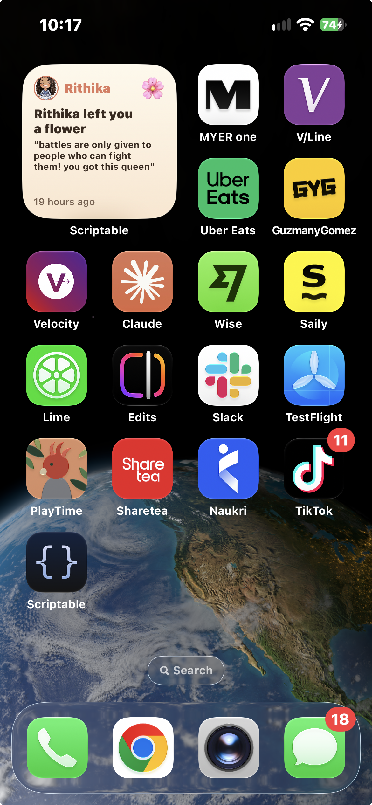
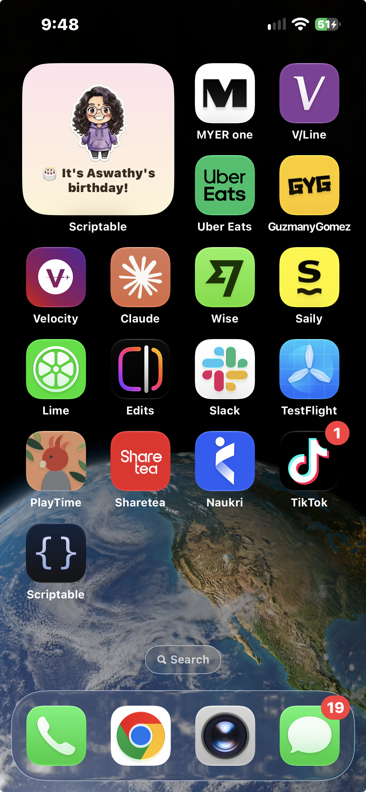
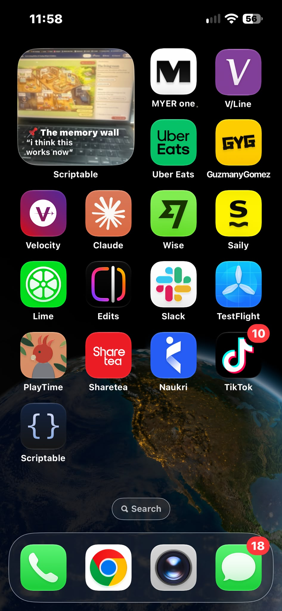
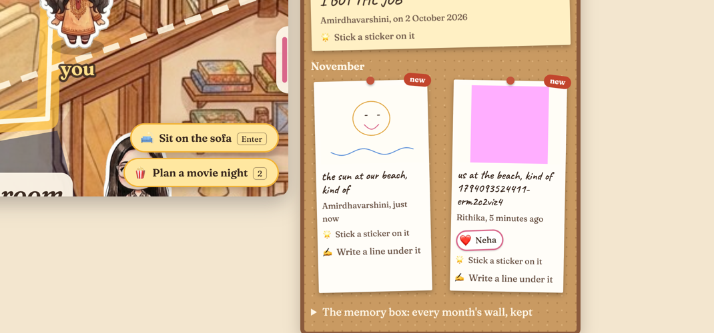

# Prompts

Every prompt I gave the agent from 8 October, word for word, with the commit it led to.

This prompt was mainly for persistence and live refresh [`cd89e32`](https://github.com/comp4020-agentic-coding-studio/comp4020-final-rithikanallaparaju16/commit/cd89e32) (written up in [`2b110a0`](https://github.com/comp4020-agentic-coding-studio/comp4020-final-rithikanallaparaju16/commit/2b110a0))

Fixed the UNO game 
[`e1c6183`](https://github.com/comp4020-agentic-coding-studio/comp4020-final-rithikanallaparaju16/commit/e1c6183)
- "push and ship it": shipped with my reflection's update in [`75b1794`](https://github.com/comp4020-agentic-coding-studio/comp4020-final-rithikanallaparaju16/commit/75b1794)

- Started to work on "make your own house" but this was creating problems because on the fly if we try to make the house after the prompt, then we use an API key, so that wasnt working very well. So I made a few designs of prefined housed and then went ahead with this plan`llm-any-friends`.
[`0997905`](https://github.com/comp4020-agentic-coding-studio/comp4020-final-rithikanallaparaju16/commit/0997905); the maker agent built `/make`, [`083033e`](https://github.com/comp4020-agentic-coding-studio/comp4020-final-rithikanallaparaju16/commit/083033e); the rooms agent gave made houses their own rooms, [`71209b0`](https://github.com/comp4020-agentic-coding-studio/comp4020-final-rithikanallaparaju16/commit/71209b0)

Here is where i worked on what information to ask the user to make their own house, Each friend will have a set of options to choose what is to be there in their room. these things are predefined
 [`17c0351`](https://github.com/comp4020-agentic-coding-studio/comp4020-final-rithikanallaparaju16/commit/17c0351); the art agent drew a chibi sticker for each, [`5b5e779`](https://github.com/comp4020-agentic-coding-studio/comp4020-final-rithikanallaparaju16/commit/5b5e779),  [`a590225`](https://github.com/comp4020-agentic-coding-studio/comp4020-final-rithikanallaparaju16/commit/a590225)

Asked agents to act as 4 friends and test the made house and report bugs and fix it.[`9289cc5`](https://github.com/comp4020-agentic-coding-studio/comp4020-final-rithikanallaparaju16/commit/9289cc5)

This is the prompt where i asked claude to use image credits and asked it to create a bunch of predefined items to use for the made house.[`9289cc5`](https://github.com/comp4020-agentic-coding-studio/comp4020-final-rithikanallaparaju16/commit/9289cc5)

I got really good insights from the guest lecturer in Week 12, His product management skills encouraged me to add more features to make this app so much better. So i used Frameworks such as PRFAQs,Personas and RICE
 `doc/`, [`63f3629`](https://github.com/comp4020-agentic-coding-studio/comp4020-final-rithikanallaparaju16/commit/63f3629)

So it gave me a bunch of ideas, most of which surprisingly made a lot of sense. The main one is that it told me that My app could be forgotten because there are not notifications, and this made perfect sense.
So i got the idea of adding it as a widget which updates whenever something happens or anything, a small widget to just let people remember this app.

This was the widget on aswathys birthday on my phone

 Made the option to upload images here.these will also be shown on the widget 

 you can also draw and leave voice notes

 [`183b473`](https://github.com/comp4020-agentic-coding-studio/comp4020-final-rithikanallaparaju16/commit/183b473)

- asked for the planner here. the time planner that i spoke about earlier[`183b473`](https://github.com/comp4020-agentic-coding-studio/comp4020-final-rithikanallaparaju16/commit/183b473)

Then i reaised the constraint of space.So how many images can the memory board hold? we do not want the app to crash so i made sumn callled the memory box where you can store thr memory you love, it could be a voice notes, image on memory wall, a note that you feel made your day wtc in your memory box. and when that fills up, you can download it to your gadget and itrs always with you before the app space gets cleared for more memories to make together. [`11c3804`](https://github.com/comp4020-agentic-coding-studio/comp4020-final-rithikanallaparaju16/commit/11c3804)

-
The toggle on the phone was a headache that i tried to fix throughout this entire process. [`74c44de`](https://github.com/comp4020-agentic-coding-studio/comp4020-final-rithikanallaparaju16/commit/74c44de)

For the widget on iphone, i used the thirdparty app called scriptable to help. [`74c44de`](https://github.com/comp4020-agentic-coding-studio/comp4020-final-rithikanallaparaju16/commit/74c44de)
- "queen, what happened to the widget thing i told you": answered, no code change: it was built and committed, but its push to the live site was blocked waiting for a go-ahead.

added note previews on widgets [`b863836`](https://github.com/comp4020-agentic-coding-studio/comp4020-final-rithikanallaparaju16/commit/b863836)

The toggle was so bad that in the phone if im in the living room that is the top part of my house, the toggle in not accessible, so wrote a few prompts to fix that issue
[`397f8b1`](https://github.com/comp4020-agentic-coding-studio/comp4020-final-rithikanallaparaju16/commit/397f8b1)

This is the memory box thing, and after every month when the user enters wheneber they feel like there will be a monthly memory hall recap.
[`d6976a7`](https://github.com/comp4020-agentic-coding-studio/comp4020-final-rithikanallaparaju16/commit/d6976a7)

tried to be over ambitious and make it into an app, but realised i needed apple developer account even to release the app on testflight lol[`d6976a7`](https://github.com/comp4020-agentic-coding-studio/comp4020-final-rithikanallaparaju16/commit/d6976a7)

Made all these chnages to the made houses as well.
[`2e3c9d2`](https://github.com/comp4020-agentic-coding-studio/comp4020-final-rithikanallaparaju16/commit/2e3c9d2)

DId a few things to avoid a login as w diff friend other than you
[`272a413`](https://github.com/comp4020-agentic-coding-studio/comp4020-final-rithikanallaparaju16/commit/272a413)

DID the producct manager stuff again and asked claude to suggest more features using rice. I was surprised by how well it works and kept doing this practice to imrpove my app a lot[`0ce7d7b`](https://github.com/comp4020-agentic-coding-studio/comp4020-final-rithikanallaparaju16/commit/0ce7d7b)

Tried fixing the toggle here again (i was so fed up with that now)
 [`5dd9db1`](https://github.com/comp4020-agentic-coding-studio/comp4020-final-rithikanallaparaju16/commit/5dd9db1)
- "- **Drawings, voice notes and real-time chat.** Possibilities in `CLAUDE.md`, not candidates until someone shows they'd make five people feel closer. wait can we do this? do it if its possible", then "Skip chat for now": draw a friend something or leave her a voice note on her desk, and pin a drawing on the wall (ADR 0037), [`18e9bbc`](https://github.com/comp4020-agentic-coding-studio/comp4020-final-rithikanallaparaju16/commit/18e9bbc)

Amirdhas name is actually AMIRDHAVARSHINi which was a very big button on the phone and would ruin the whole experience to rice suggested to make it shorter.it was surprising how most of the suggetsion were legit. [`4c8364c`](https://github.com/comp4020-agentic-coding-studio/comp4020-final-rithikanallaparaju16/commit/4c8364c)

now i realised i was too close to the deadline and should stop having fun and start my work to score a good grade. so i asked my agent to review and tell me more chnages [`442893a`](https://github.com/comp4020-agentic-coding-studio/comp4020-final-rithikanallaparaju16/commit/442893a)
